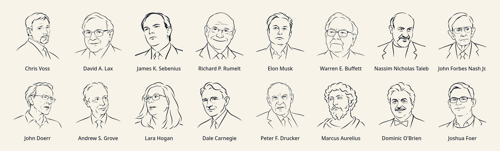

<p align="center"></p>

<h1 align="center">World-Class Skills</h1>

**Give your AI agent the playbooks of world-class negotiators, strategists, investors, and leaders.**

Eleven playbooks, packaged as agent skills, distilled from the people who set the standard in their field: an FBI hostage negotiator, the Harvard Negotiation Project, the CEO who built Intel, the investor behind Berkshire Hathaway, a Nobel-winning mathematician, an eight-time World Memory Champion, and more. Each framework is turned into a working method your agent applies to *your* situation: a reply draft, a strategy critique, a decision memo, a 1:1 plan.

You don't call a playbook by name. Ask your agent to review a strategy doc, prepare a salary negotiation, or decide which projects to kill. The right playbook loads, picks the best-fit framework, and tells you which one it used.

Works with Claude Code, Codex, Cursor, Gemini CLI, OpenCode, Amp, pi, Crush, GitHub Copilot, and every other agent that reads the open `SKILL.md` format.

```bash
npx skills add Phazz/world-class-skills -g -y
```

## What you get

| Playbook | Ask it to... | Drawn from |
| --- | --- | --- |
| `negotiation-playbook` | prepare a negotiation, compare offers, reply to pushback, unstick a deal | **Chris Voss**, former FBI lead international kidnapping negotiator · **Roger Fisher & William Ury**, Harvard Negotiation Project · **David Lax & James Sebenius**, Harvard Business School |
| `strategy-playbook` | write or tear apart a strategy, set engineering policy, cut bloat | **Richard Rumelt**, the strategy kernel · **Will Larson**, engineering executive at Uber, Stripe, and Carta · **Elon Musk**, SpaceX's five-step engineering algorithm |
| `decision-playbook` | judge a company, a big commitment, a risky bet, a competitor's response | **Warren Buffett**, Berkshire Hathaway · **Nassim Nicholas Taleb**, *Incerto* · **John Nash**, Nobel laureate in economics |
| `planning-playbook` | choose what to start or stop, plan the year, write OKRs that mean something | **John Doerr**, who brought OKRs from Intel to Google · **Will Larson**, executive planning · portfolio discipline |
| `management-playbook` | fix a team that isn't delivering, delegate, run 1:1s, lead as Staff+ | **Andy Grove**, CEO who built Intel · **Will Larson**, *An Elegant Puzzle* and *Staff Engineer* · **Lara Hogan**, engineering leadership coach |
| `communication-playbook` | write the weekly update, deliver hard feedback, repair a relationship | **Dale Carnegie** · **Will Larson**'s 5-15 update practice |
| `growth-playbook` | design an offer, price it, find customers, fix funnel economics | **Alex Hormozi**, *$100M Offers*, *Leads*, and *Money Models* |
| `ui-design-playbook` | design a page, screen, logo, or icon that doesn't look AI-generated | **Anshu Chimala**'s world-class design techniques (Lenny's Newsletter) · **Sakana AI**'s String Seed of Thought research |
| `direction-playbook` | decide where your time goes, choose a role, handle a setback | **Peter Drucker**, the father of modern management · **Marcus Aurelius**, Roman emperor and Stoic |
| `investing-playbook` | review household investments, rebalance, write an investment policy | Diversification and allocation principles from regulators, with Buffett and Taleb as lenses |
| `memory-playbook` | learn memory palaces and the Dominic number system, step by step | **Dominic O'Brien**, eight-time World Memory Champion · **Joshua Foer**, USA Memory Champion |

## The people behind the playbooks

<p align="center"></p>

<sub>Original line-art illustrations drawn from openly licensed photographs; credits and licences in [assets/portraits/CREDITS.md](assets/portraits/CREDITS.md). Portraits of other authors cited above will be added as image rights are cleared.</sub>

## The habits that make them world-class, built in

The best practitioners in these fields share a handful of habits. Every playbook enforces them, so the output holds up to scrutiny instead of just sounding confident:

- **Diagnose before prescribing.** Name the real challenge and the evidence for it before proposing anything (Rumelt, Grove, Larson).
- **Know your alternative.** Every negotiation has a walk-away; every commitment is compared with its opportunity cost, including waiting (Fisher & Ury, Buffett).
- **Bound the downside.** Find the irreversible losses first, and prefer small experiments with clear stop and expand criteria (Taleb).
- **Delete before you optimize.** Question each requirement, cut, and only then speed up or automate (Musk).
- **Listen before persuading.** Understand the other side's constraints and let their answers change the plan (Voss, Carnegie).
- **Concentrate.** Choose the few things that matter and say explicitly what gets less attention (Drucker, Rumelt, Doerr).
- **Facts, not stories.** Separate what happened from the judgment about it; label hypotheses and unknowns instead of inventing them (Marcus Aurelius, every playbook).
- **Break the default.** Seed creative work with randomness, aim high, and let an independent critic judge the result (Chimala, Sakana AI).
- **Commitments have owners.** Every plan ends with who does what by when, and how you'll know it worked.

## Try it

Talk to your agent the way you normally would:

> "Here's our 2027 platform strategy draft — tear it apart."
> "A recruiter offered 140k, I want 160k and have another final round. Draft my reply."
> "On-call doubled and the roadmap keeps slipping. Hire or reorg?"
> "We're about to sign a 5-year all-in deal with one cloud vendor. What could go wrong?"
> "Seven initiatives, capacity for four. Which do we pause?"
> "Turn these notes into my weekly update for my VP."

Variations of each prompt are in the test suite, which checks that the right playbook fires and that unrelated requests (a README typo, a trivia question) trigger nothing.

## Install

**Every agent on your machine, one command.** The CLI detects which agents you have and installs only for those:

```bash
npx skills add Phazz/world-class-skills -g -y
```

Update everything with `npx skills update -g -y`. See `npx skills add --help` to install only some playbooks or agents.

**Or as a native plugin**, with background auto-update in Claude Code. Use one method or the other, not both, or each playbook loads twice:

```bash
claude plugin marketplace add Phazz/world-class-skills && claude plugin install work@world-class-skills
codex plugin marketplace add Phazz/world-class-skills && codex plugin add work@world-class-skills
```

The `personal` plugin (`direction-playbook`, `investing-playbook`, `memory-playbook`) installs the same way.

## How it works

Each playbook is a job, not an author. Its description tells the agent *when* it applies, in the words you'd actually use. Its body is a short router that picks the right framework for your situation. The frameworks live in `references/` and load only when needed, so eleven playbooks cost only eleven short descriptions of context until one is needed.

```
plugins/<plugin>/skills/<job>-playbook/SKILL.md          # when to use + framework router
plugins/<plugin>/skills/<job>-playbook/references/*.md   # one framework per file, loaded on demand
plugins/<plugin>/evals/<case>/                      # trigger tests
.claude-plugin/ and .agents/plugins/                # Claude Code and Codex marketplace manifests
```

## Contribute or customize

- Add a framework by dropping a file into the right job's `references/` and adding a row to that job's lens table. Add a new playbook only when no existing description fits.
- Work on a branch and open a pull request. CI validates the manifests, playbook names, links, versions, and portrait credits (`python3 scripts/check.py` runs the same checks locally).
- After changing a description, run the trigger tests locally: `claude plugin eval work --ablation none --runs 3 --no-publish` (and the same for `personal`).
- Links between playbooks are relative paths that assume every `*-playbook` folder sits side by side, as `npx skills` installs them.

## Releases

Releases follow [semantic versioning](https://semver.org/) and are listed in [CHANGELOG.md](CHANGELOG.md): a major version renames or removes a playbook, a minor version adds one, a patch improves wording or triggering. To release, bump `version` in the four plugin manifests, add a CHANGELOG entry, merge, then push a `vX.Y.Z` tag; the release workflow publishes the GitHub release. Plugin installs update when the version changes; `npx skills update` always takes the latest `main`, which only receives reviewed, passing changes.

## Sources and fair use

Each framework file ends with its sources: official sites, primary texts, and the authors' own public writing. The workflows are original operational adaptations of selected ideas, not summaries or reproductions of the books; read the originals, they are worth it. This project is not affiliated with or endorsed by any of the people or organizations named, and the portraits do not imply endorsement.

## License

The playbooks, manifests, and tests are MIT licensed. The portraits in `assets/portraits/` are illustrations derived from openly licensed photographs and are licensed per image as listed in [CREDITS.md](assets/portraits/CREDITS.md): derivatives of CC BY-SA photos keep that licence; the others are CC BY-SA 4.0. `assets/people.png` is a compilation of those portraits; each keeps its own licence. The owl icon is MIT licensed with the rest of the repository.
